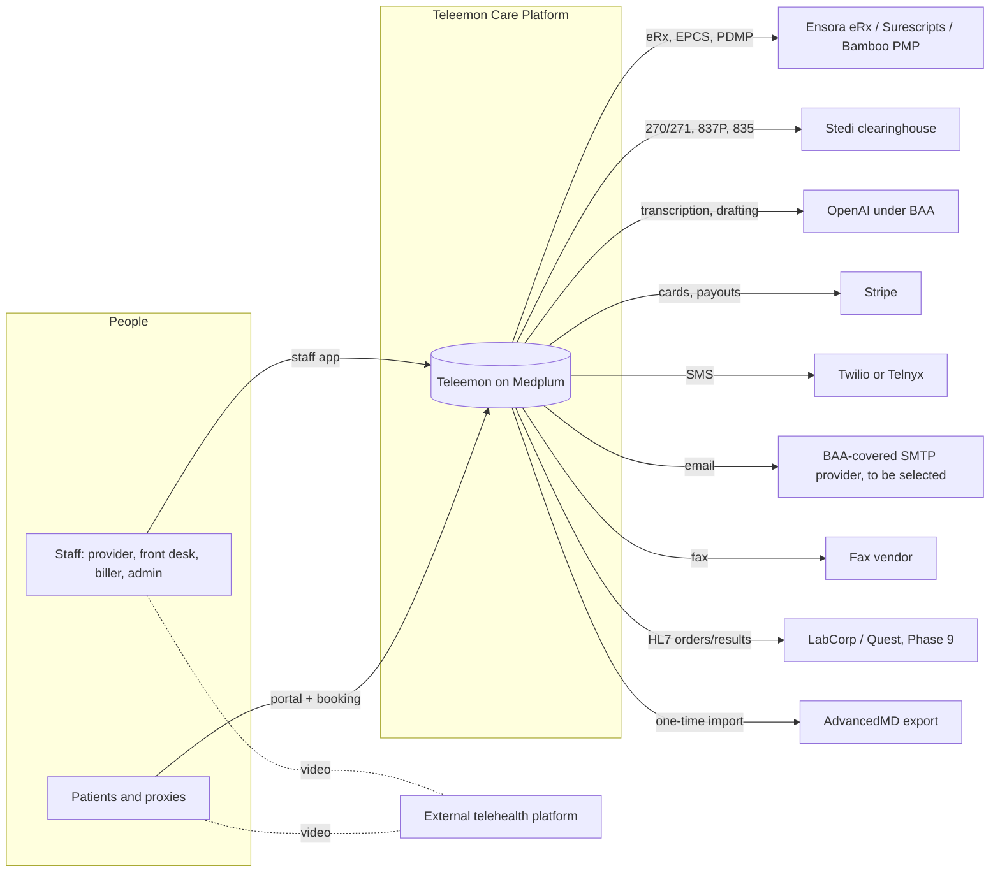
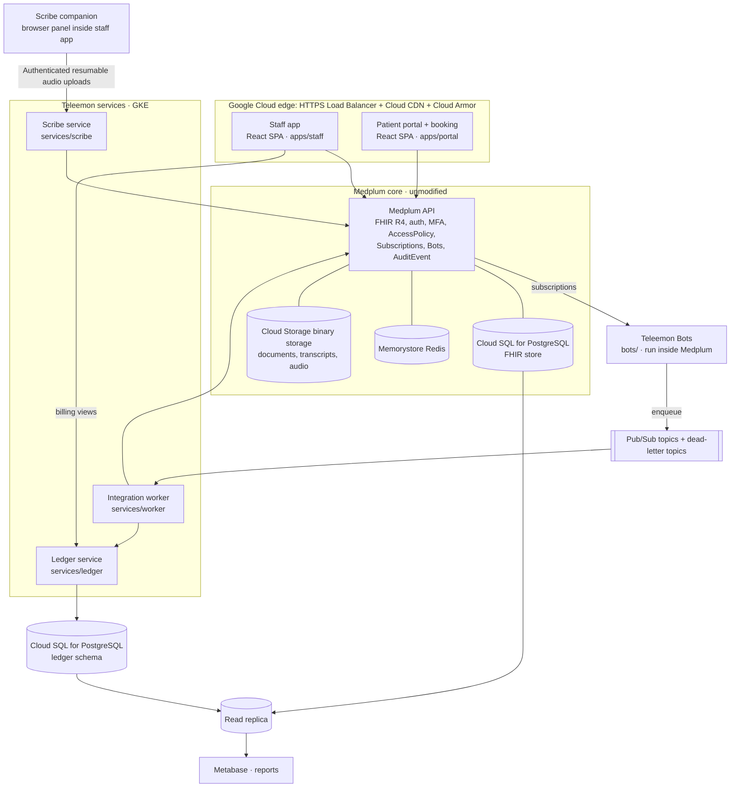
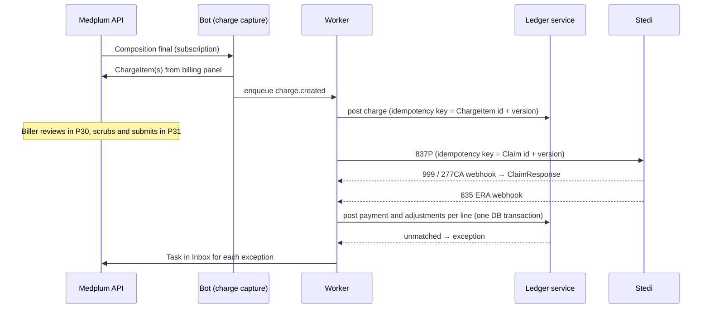

# Teleemon Care Platform: system design

Version 0.6 · 18 October 2026 · Status: **draft for review** (Phase 8 revenue cycle added: ledger service, charge and claim rules, clearinghouse adapter with a mock test payer; Stedi, Stripe, email and counsel items pending)
Inputs: scope v1.0 (sections 7, 8, 17–19), [IMPLEMENTATION-PLAN.md](IMPLEMENTATION-PLAN.md), Medplum 5.2.4 source.

This document says how the system is built: which components exist, where each rule is enforced, how data flows, and where it runs. Each significant choice is recorded as a decision (ADR) in section 11, together with the phase that depends on it. When code and this document disagree, one of them is wrong; fix whichever it is in the same change.

---

## 1. Goals and constraints that shape the design

| Driver | Consequence for the design |
|---|---|
| Single practice, 1 provider, growing to 5 | One Medplum project, one tenant. Nothing multi-tenant. Sized small, but no shortcut blocks a second provider. |
| HIPAA, multi-state law, controlled substances | **Rules are enforced on the server**, never only in the UI. Every vendor that touches PHI has a BAA before data flows. |
| Medplum Community, self-hosted | We run security, backups and upgrades, so **Medplum is never modified**. Teleemon behaviour is added through configuration, Bots, AccessPolicies and separate services. |
| Billing must reconcile to the cent | The money ledger is a dedicated, transactional store, not a set of loosely related FHIR resources (ADR-005). |
| Independent audio scribe with a consent gate | Google Meet carries video; a dedicated GCP scribe service owns capture ingest, OpenAI transcription and structured drafts. Record during the visit; transcription and drafting begin after stop and finalized upload. Live transcription is excluded. The browser never talks to the AI vendor directly (ADR-006). |
| Small team (4 engineers) | Few moving parts: one language (TypeScript), one database engine (PostgreSQL), managed Google Cloud services, one repo. |

## 2. System context



## 3. Containers



| Container | Responsibility | Tech | Owns data? |
|---|---|---|---|
| Staff app | All 45 staff pages; no business rules that aren't also enforced server-side | React, Mantine, `@medplum/react` | No |
| Patient portal | X01–X09; the public booking page is the only unauthenticated surface. Reads the patient's own compartment from the Medplum API directly | React, Mantine, `@medplum/core` | No |
| Portal service | Public booking (free times, proof-of-work check, held bookings), invitation links and sign-in creation, and the portal writes that carry rules: booking, cancelling, check-in, the join link, e-signatures and card on file (ADR-012) | Node, two Medplum clients (least privilege; accounts administrator for invitations only) | Invitation hashes on Basic |
| Medplum API | The system of record for clinical and administrative data; authentication, MFA, access control, audit, subscriptions, Bot runtime | Medplum 5.x (configuration only) | FHIR store, Cloud Storage |
| Bots | Short, event-driven logic **inside** the Medplum trust boundary: pre-commit rule checks, derivations, enqueueing integration jobs | TypeScript, Medplum Bot runtime (`vmcontext`) | No |
| Integration worker | Everything that talks to a vendor: retries, idempotency, rate limits, polling, webhooks | Node on GKE, Pub/Sub | Job state only |
| Scribe service | Audio ingest, session authorization/consent, resumable upload, after-visit file transcription, evidence-linked draft proposals, audio retention | Node on GKE, authenticated resumable uploads and background jobs | Transcript and audio through Medplum/Cloud Storage; job state |
| Ledger service | Double-entry patient and insurance ledger, posting, balances, reconciliation | Node on GKE, PostgreSQL (separate schema and credentials) | **Yes**: financial source of truth |
| Reporting | Read-only analytics on a replica | Metabase | Derived views only |

Rule of placement: **Bots for logic that must run inside a write; the worker for outbound vendor calls; services for anything long-running or stateful.**

## 4. Data architecture

### 4.1 FHIR conventions (implemented in `packages/core/src/fhir.ts`)

| Convention | Value |
|---|---|
| Base URL for Teleemon profiles, extensions and code systems | `https://fhir.teleemon.com` |
| Extensions | `/StructureDefinition/visit-modality` (video, phone, office); `/StructureDefinition/patient-location-state` (two-letter state) on Appointment and Encounter |
| Identifier systems | `/identifier/seed` (synthetic data only); later `/identifier/advancedmd` (migrated records), `/identifier/stedi-claim`, `/identifier/ensora-rx` |
| Times | Instants stored in UTC; displayed in the practice zone (America/Los_Angeles) and the patient's zone |
| New extensions | Added here first, then to `packages/core/src/fhir.ts`, with a FHIR StructureDefinition loaded into the project in the same phase |

The resource mapping follows scope section 17. Additions:

| Concept | Storage |
|---|---|
| Licence and DEA registration per state | `Practitioner.qualification` (code system `/CodeSystem/qualification-type`; `identifier` = number; `period.end` = expiry). DEA uses a distinct code plus its schedules in an extension. |
| Recording consent per session | `Consent` with `provision.data` → Encounter; `Encounter.extension` references it |
| Signed note | `Composition` (status `final`, `attester` = provider), versioned; addenda are new Compositions that `relatesTo.replaces/appends` it |
| PDMP check | `Task` (code `pdmp-check`, `executionPeriod`, `output` = state and result reference), so "check in the last 24 hours" is a search |
| Scribe transcript | `DocumentReference` (category `transcript`) → `Binary` JSON of stable timestamped segments, source and speaker/unknown labels; finalized after-visit transcript |
| Scribe audio | `Binary` in Cloud Storage under a dedicated prefix with an object lifecycle rule as a backstop to the retention job |
| Scribe proposals and provenance | Encounter/session-linked versioned proposal with field values, supporting segment IDs and missing/conflict flags; record model, template/instruction version, chart-context version and base Composition version. Accepted content uses NoteData/Composition plus Provenance; no automatic Conditions, orders, attestations or signatures. Session schema version 1 uses SCRIBE_DATA on a transcript-category DocumentReference; audio Binary resources inherit its securityContext. See packages/core/src/scribe.ts and the Phase 4 record. |
| Inbox items | `Task` with `focus` = the inbound resource; status drives the queue |
| Portal invitation (Phase 7) | `Basic` (code `/CodeSystem/portal` `invitation`), `identifier` = SHA-256 of the link token, `subject` = Patient or RelatedPerson, extensions for expiry, use and the held Appointment. Staff request one with a `Task` (code `portal-invite`) |
| Online booking (Phase 7) | `Appointment` with extensions `booking-channel` (online, portal), `hold-expires` (unconfirmed public bookings are `pending`) and `location-confirmed` (by, at, state) at check-in |
| Portal messages (Phase 7) | `Communication` category `portal-message` (patient to practice, same queue and closing rules as texts) and `portal-reply` (staff reply, immutable; `notified-at` when the patient is emailed) |
| E-signed consent (Phase 7) | `Consent` with `consent-method` = portal-esignature, `consent-document` (version), `consent-text-hash` (SHA-256 of the exact text), the signed text as `sourceAttachment`, performer = signer |
| Card on file (Phase 7) | `Patient` extension `card-on-file` (JSON: processor customer and payment method IDs, brand, last four, expiry); written only by the portal service |

### 4.2 What is *not* in FHIR

| Data | Store | Why |
|---|---|---|
| Ledger entries, balances, payment allocations | Ledger DB (ADR-005) | Needs multi-row atomic transactions and invariants ("balance = charges − payments − adjustments") enforced by the database |
| Integration job state and dead letters | Pub/Sub + worker table | Operational, short-lived |
| Card data | Stripe only | PCI scope stays with Stripe; we store Stripe IDs |
| Secrets and vendor credentials | Google Secret Manager (Medplum project secrets for Bots) | Never in code, env files in images, or the browser |

### 4.3 Retention

| Data | Default | Mechanism |
|---|---|---|
| Medical record (FHIR) | Longest applicable state rule; **attorney to confirm** | Never hard-deleted by the app; soft status only |
| Scribe audio | Proposed: deleted 7 days after signing, configurable and subject to approved policy; define an unsigned/abandoned-session limit; legal hold overrides | Retention worker checks signing and holds, deletes Binary plus stored objects/versions/temp chunks and audits the result. Any lifecycle backstop must respect holds and the approved policy; no unconditional 30-day deletion. Backup/vendor lifecycle reviewed separately. |
| Transcript | Same as the medical record | — |
| AuditEvent | At least 6 years | Exported nightly to Cloud Storage with a locked retention policy (Bucket Lock) |
| Ledger | At least 7 years | Append-only; no deletes |

## 5. Identity and access

### 5.1 Who signs in, and how

| Principal | Mechanism |
|---|---|
| Staff | Medplum login with project setting `mfaRequired = true` and `allowedMfaMethods = totp` (`scripts/setup.ts`). Idle timeout 15 min in the app; token lifetime set to match in the ClientApplication |
| EPCS signing | Ensora's own two-factor credential, separate from Medplum MFA |
| Patients and proxies | Separate public portal ClientApplication (PKCE, 30-minute tokens, no membership). Project-scoped users created from single-use invitation links by the portal service; patient profile = Patient, proxy profile = RelatedPerson with the patient as a policy parameter (ADR-012) |
| Bots | Bot membership with a Bot-specific AccessPolicy (least privilege per Bot) |
| Services and scripts | ClientApplications (client credentials), one per service, each with its own AccessPolicy. `Teleemon scripts` is admin-only and is never deployed to production |

### 5.2 Authorization model (enforced by Medplum on every request)

One AccessPolicy per role, assigned on ProjectMembership. The staff app reads the policy name to build menus (`session/roles.tsx`); **the policy, not the menu, is the control.**

| Policy | Read | Write | Notable restrictions |
|---|---|---|---|
| `Teleemon Provider` | Clinical and administrative resources | Clinical resources, Composition, MedicationRequest (through eRx sync), Task | `writeConstraint`: a final Composition cannot be modified |
| `Teleemon Front desk` | Demographics, Coverage, Eligibility (270/271), Appointment, DocumentReference (non-clinical categories), Communication, Task | Same, but only creates eligibility requests (never responses) | `hiddenFields` on clinical notes; no Composition, Condition or MedicationRequest write |
| `Teleemon Biller` | Patient (demographics), Coverage, Encounter (billing fields), Claim, ClaimResponse, ChargeItem | Claim, ClaimResponse, ChargeItem, Task | No note contents |
| `Teleemon Admin` | Everything, plus audit | Configuration resources | Clinical writes off by default |
| `Teleemon Patient` | Own Patient, appointments (extensions and comments hidden), practitioners (names only), after-visit summaries, portal messages, questionnaire responses, consents, coverage, medications, refill requests | Own contact details (Patient Bot limits the fields); portal messages and refill requests (create only); questionnaire responses (locked once completed); draft coverage | `%patient` criteria on every type (`scripts/config/portal.ts`); bookings, check-in and consents only through the portal service |
| `Teleemon Proxy` | As patient, for the linked patient (`%patient` membership parameter) | As patient | Used when `proxyLevel` is full (minor under the state age) |
| `Teleemon Proxy (limited)` | Linked patient's demographics (contacts and extensions hidden), appointments and coverage | None directly; scheduling, check-in and the financial consent through the portal service | Used when the minor has reached the state age; reviewed hourly, ended at 18 |

Record-level overlays planned for compliance hardening (not implemented in the current role policies):
- **Restricted charts** (VIP, staff-as-patient): a security label `R` on Patient and its compartment. The staff UI currently requires a fresh audited reason on each chart opening. This is a UI workflow, not server-side compartment isolation. Server grants, compartment filtering and administrator alerts remain Phase 9 work.
- **42 CFR Part 2** (off until decision D2): an SUD security label on the relevant resources; it is excluded from every policy except the provider's and requires a Consent check on export.

## 6. Where each hard rule is enforced

The UI repeats rules for good UX, but each rule has exactly one **authoritative** enforcement point. Shared logic lives in one pure TypeScript package, `packages/core` (ADR-004), imported by the app, the Bots and the services, so the answer is the same everywhere.

| Rule (scope ref) | Authoritative enforcement | Also shown in |
|---|---|---|
| MFA for all staff (P01) | Medplum project setting `mfaRequired` | Settings page status |
| Role permissions (§5) | AccessPolicy | Menus |
| No booking in an unlicensed or expired state (P05, P39) | Pre-commit Bot `appointment-rules`, using `@teleemon/core` `checkLicensure` while a visit is proposed/pending/booked. Check-in records the reported location; starting a visit in an unlicensed state is blocked by the encounter rule (Phase 3) | Booking drawer (live check), calendar, Today alerts |
| No double booking or booking over blocked time without a reason (P04) | Same Bot: overlap with active appointments and `busy-unavailable` Slots, unless `overbook-reason` is present | Booking drawer offers free times only |
| Visit eligibility and recording consent (P12, P22) | Existing encounter Bot enforces visit-start rules. Scribe service separately verifies identity, patient/encounter, location/licensure and recording-specific session consent before ingest and vendor dispatch; resume rechecks and withdrawal stops capture/dispatch. Recording refusal leaves manual documentation available. | Scribe pre-flight |
| AI cannot overwrite reviewed or signed content (Phase 4 implemented locally) | Scribe apply validates patient/encounter, draft status and expected Composition version; conflicts return for review. Existing note-rules and canonical signing remain authoritative. | Per-field proposal review and evidence links |
| A signed note is immutable; amend by addendum (P23) | Two independent guards: the provider AccessPolicy `writeConstraint` (`%before.status = 'preliminary'`) and the `note-rules` pre-commit Bot, which also refuses edits and deletes by admins and service accounts. Addenda and corrections are new Compositions with `relatesTo` appends/replaces | Signed view has no edit controls |
| Only the visit's provider signs (P23) | `note-rules`: the one legal attester must match the trusted `meta.author` that Medplum assigns before pre-commit validation, and be a participant of the note's Encounter. Attestation time and late-entry flags are assigned by the Bot | Sign button only for that provider |
| A visit cannot start in an unlicensed state (P21) | `encounter-rules` pre-commit Bot when an Encounter becomes `in-progress` or its location changes | Start visit shows the server's reason |
| A note needs at least one diagnosis; add-on psychotherapy time thresholds (P21) | `note-rules` on Composition → `final`, using `@teleemon/core` `signProblems` (diagnoses, risk and safety plan, MSE, assessment, plan, medications reviewed, visit code, add-on minutes, no time-based E/M with an add-on). The submitted narrative must equal shared `noteSections` output, including the saved measures snapshot; direct `amended` creation is refused; amendments must match the original patient and encounter | Pre-sign checklist, highlighted sections |
| Signing completes the visit consistently (P23) | One version-checked FHIR transaction writes the signature, encounter finish and appointment fulfillment. Project feature `transaction-bundles` is required and enabled by setup | Failures leave the draft unsigned; signed records from older partial workflows have an idempotent Complete visit recovery action |
| Draft edits survive in-app navigation (P21) | Serialized revision-aware save queue drains all changes before review/navigation; failed writes leave the draft dirty | Router navigation waits for saving; browser unload warns while dirty or saving |
| Private psychotherapy notes are never exported (P24) | Export builders read rendered sections only; `privateNotes` is never rendered | Export descriptions |
| Controlled Rx needs a PDMP check within 24 hours and a state DEA registration (P25) | `prescription-rules` pre-commit Bot (licence, DEA schedule coverage, refill limits, the prescriber's own cited PDMP check, sender = prescriber via `meta.author`, sent prescriptions locked); `task-rules` Bot (PDMP checks recorded at the time, by their owner, immutable); provider policy cannot mark sent; the vendor enforces EPCS once connected | Prescribe form, Prescriptions card, P25 |
| No inbound item is lost: every item is assigned, filed or closed with a reason (P03) | `task-rules` Bot (non-completion needs `statusReason`; filed fax reviews stay closed); `communication-rules` Bot (messages close with a handling note); no role can delete Tasks, faxes or messages | Inbox, Tasks, Fax centre |
| A fax or unmatched message is filed to a patient only after a person confirms the match (P03, P28) | `document-rules` / `communication-rules` Bots: a fresh `match-confirmed` extension by the signed-in user (`meta.author`); removal needs a reason | Fax centre, message drawer |
| Lab results are reviewed by a provider, under their own name, once (P16) | `document-rules` Bot (review by = author, final); front-desk policy cannot add a review; `result-review` Bot creates and closes the review Task | Labs tab, Inbox |
| Duplicate patient (P08) | Pre-commit Bot `duplicate-patient` rejects a match unless the record carries an override reason; role AccessPolicies use a `writeConstraint` so only administrators can add that reason | Registration form (live warning) |
| Minor registration (P08) | Patient pre-commit Bot requires a guardian snapshot with name, relationship, phone and confirmed authority on `Patient.contact`; RelatedPerson is saved in the same registration transaction | Registration |
| Diagnosis validation (P13) | Condition pre-commit Bot validates catalogue codes and refuses unresolved duplicates | Problem editor |
| Medication monitoring (P14) | Post-commit MedicationStatement Bot conditionally creates one monitoring Task per medication, including API entries | Medication tab |
| Every patient has a chart number (P08) | Same pre-commit Bot assigns `TM-xxxxxxxx` when missing | Header, search |
| Positive safety item always alerts (P15) | Pre-commit measure validation; post-commit `measure-scoring` conditionally creates the score, Flag and stat Task in one FHIR transaction, repairing earlier partial deliveries on retry | Measures entry warning, Today alerts |
| Audit log is append-only; roles never hard-delete (P45, §4.3) | AccessPolicy `interaction` lists: AuditEvent create-only, no `delete` on any role | — |
| No SMS to opted-out numbers; quiet hours (P20, P42) | Worker `deliverQueued`, immediately before sending; STOP/START replies update the opt-out at once | Communications tab, Messaging settings |
| Reminders contain no clinical detail (P42) | `templateProblems` refuses clinical wording when templates are saved; reminders are idempotent per appointment, offset and channel | Messaging settings preview |
| Ledger balances (P19, P33) | Database constraints and transactions in the ledger service | A/R dashboard |
| Online bookings: video visit types offered online, 15-minute grid, practice hours, 24 hours ahead for new patients and 2 for returning, at most 60 days (X01, X03) | Portal service (`onlineBookingProblem` before writing) and the `appointment-rules` Bot for any Appointment with a booking channel, plus the existing licensure and conflict checks | Booking pages offer only valid times |
| Patients cannot write appointments, consents or cards directly (X02–X04) | Patient and proxy policies (Appointment, Consent read-only; Patient Bot refuses card and registration changes) | Portal service routes |
| Join link only after check-in with a confirmed, recent licensed location (X04) | Policy hides Appointment extensions from patients; the portal service releases the link only when the Appointment is arrived with a location confirmation newer than `locationFreshHours`, and refuses check-in from an unlicensed state. When the patient's confirmation is missing or stale, the provider re-confirms on camera (recorded on the Encounter) | Join button appears after check-in; a stale confirmation asks for renewal |
| A proxy sees only what the minor's age and state allow (X09) | Policy chosen per membership by `proxyLevel`; the portal accounts job reviews it hourly; the portal service recomputes it on every request | Navigation hides clinical pages |
| Portal messages and refill requests: own name, own patient, one open refill per medication; crisis language marked urgent (X05, X07) | `communication-rules` and `task-rules` Bots; create-only policies | Message and refill forms; crisis panel |
| Invitation links are single-use and expire; only hashes are stored (§9) | Portal service (`findInvitation`, `activate`) | Activation page |
| Ledger balances to the cent; append-only; exact reversals; idempotent postings (ADR-005) | PostgreSQL constraints and triggers in `services/ledger/schema.sql`; the ledger service refuses a replayed key with different amounts | P19, P33, P36 |
| Charges move planned → billable → billed in order; billable needs a payer, a diagnosis and a whole-cent amount; AI-suggested codes are billable only after the rendering provider accepts them; posted charges are frozen; charges are never deleted (P30) | `charge-rules` pre-commit Bot (also keeps the work-queue tags, since R4 ChargeItem has no status search) | Charge review |
| A claim is sent only after the server's own scrub passes; submitted claims are locked; one live claim per visit; payer outcomes only from the clearinghouse (P31) | `claim-rules` pre-commit Bot re-runs `scrubClaim` on the server and replaces any client-written result | Claims workbench |
| Write-offs: small balances up to the policy limit by a biller, everything else by an administrator; refunds never exceed credit held; front desk records only cash and check (P19, P34) | Ledger service role checks (roles from `auth/me` → `accessPolicy.basedOn`) | Account tab, Denials |
| Posted ERA cash equals the payer's total for every 835 (P33) | `ledger.remittance` (schema v2) and `reconcile()` | Remittance, A/R dashboard |
| Patients under 18 are not invited to their own sign-in (ADR-012 until the teen age is decided) | Portal service (`patientInviteProblem` in `invitations.ts`) and the `task-rules` Bot (a `portal-invite` Task for a minor's Patient is refused); the staff card hides the button | Portal access card explains the guardian route |
| A new patient is marked verified only when registration details, insurance, card and required consents are on file (PATIENT-ONBOARDING-PLAN stage 10) | `task-rules` Bot refuses completing an `onboarding-review` Task while `onboardingProblems` reports anything missing | Onboarding card lists what is missing |
| Insurance card photos: a patient uploads only to their own record, in the id-insurance category, preliminary, images or PDF up to 10 MB | Patient policy (DocumentReference criteria and writeConstraint on `docStatus`) and the `document-rules` Bot (`portalUpload`) | Portal insurance step; staff mark checked |
| Sex assigned at birth is set once by the patient and corrected by staff; patient-set gender follows it | Patient self-edit rules in `patientSelfEditProblem` (Patient Bot) | About you step |
| Controlled-substance agreement is required only while a controlled medication is active; good-faith estimate acknowledged per self-pay visit | `onboardingProblems` (review Bot) and `consents` route in the portal service; estimate recorded as a Consent with its text hash | Consents step; estimate card |
| Audit is immutable (P45) | Medplum AuditEvent (system-written) plus Cloud Storage Bucket Lock | Audit page |

Pre-commit Bots need two switches (a configuration change, not a code change): server config `preCommitSubscriptionsEnabled: true` and the project setting `preCommitSubscriptionsEnabled`. Their latency adds to every matching write, so each must stay small, avoid outbound network calls, and be covered by tests.

## 7. Key flows

### 7.1 Booking with licence check (Phases 2 and 7)

```mermaid
sequenceDiagram
  participant U as Staff app / portal
  participant M as Medplum API
  participant B as Pre-commit Bot (licence)
  participant W as Worker
  U->>M: POST Appointment (patient location state, start)
  M->>B: validate (interaction=create)
  B->>B: rules.canSeePatientIn(state, date, practitioner qualifications)
  alt not licensed or expired
    B-->>M: reject (OperationOutcome: plain-English reason)
    M-->>U: 400; drawer shows reason and alternatives
  else ok
    B-->>M: accept
    M-->>U: 201 Appointment
    M->>W: Subscription → enqueue confirmation + ICS + reminders
  end
```

### 7.2 Telehealth session with AI scribe (Phase 4)

Status: implemented locally; see [verification/phase-4.md](verification/phase-4.md) for actual test evidence and open gates. See [TELEHEALTH-SCRIBE-PLAN.md](TELEHEALTH-SCRIBE-PLAN.md) for delivery stages, support matrix, costs and acceptance gates. Google Meet provides the call only; its transcript is not used. Independent capture is conditional on verified browser/OS support and explicit user sharing; a meeting link does not grant access to media. Office mode uses microphone capture.

```mermaid
sequenceDiagram
  participant C as Scribe companion (supported browser)
  participant S as Scribe service
  participant M as Medplum API
  participant O as OpenAI (BAA, approved endpoints and retention)
  C->>S: request encounter-bound capture session
  S->>M: verify identity, patient, Encounter, location, licence and session Consent
  alt authorization and consent valid
    S-->>C: short-lived capture authorization
    C->>S: authenticated sequenced mic + remote-audio chunks
    S-->>C: persisted-chunk acknowledgements
    C->>S: stop and finalize upload
    S->>O: transcribe captured audio (4B)
    O-->>S: finalized transcript
    S->>M: persist versioned transcript and evidence offsets
    S->>M: read permitted chart context and current draft version
    S->>O: template + transcript + selected context; structured output schema
    O-->>S: field proposals with evidence segment IDs
    S-->>C: validated proposals, missing/conflicting items
    C->>S: provider accepts/edits fields; expected draft version
    S->>M: version-checked preliminary Composition + provenance
  else consent missing, unauthorized or location unlicensed
    S-->>C: refuse capture; manual documentation remains available
  end
  Note over C,O: No transcription during recording; OpenAI processing starts after stop and finalized upload
  Note over S,M: Retention worker follows approved signing-based policy and legal holds
```

Design points: no persistent local audio cache; bound browser memory and warn about unacknowledged audio on close. Transcript content remains faithful; template instructions affect the draft. Each clinical assertion must have valid evidence or be marked unsupported for review; unknown speakers remain unknown, especially with interpreters/caregivers. Audio conveys no visual examination findings. No automatic normal risk/MSE findings, diagnosis writes, prescribing, billing attestations, private-note population or signing. Apply accepted proposals through the existing revision-aware saver with server version checks, never silently replacing provider edits. The vendor remains behind `transcribe`/`draft` adapters; capture is limited to authorized Meet tab audio and provider microphone. Two full-duration transcription streams can double billable audio minutes; the cost baseline and rollout budget must record the selected stream layout.

### 7.3 Claim to cash (Phase 8)



### 7.4 Integration reliability pattern (all vendors)

1. A Bot or service writes the FHIR change, and a Subscription enqueues a job in Pub/Sub. The job carries an **idempotency key** derived from the resource id and version.
2. The worker calls the vendor, retries with backoff on transient errors, and records the vendor's ID back on the resource (`identifier`).
3. After the final failure, the job lands in the dead-letter queue, and the worker creates an **Inbox Task** (P03 "System alerts"), so no failure is silent. P44 shows per-vendor health.
4. Inbound webhooks (Stedi, fax, Twilio, Stripe) are verified by signature, stored raw in private Cloud Storage, and then processed once, keyed by the vendor event ID.

## 8. Deployment

| Environment | Purpose | Data | Where |
|---|---|---|---|
| Local | Development | Synthetic (`npm run seed`) | Developer PC (current `local-runtime`) |
| Staging | Phase verification, vendor sandboxes | Synthetic only | GCP, separate project |
| Production | Live practice | PHI | GCP, separate project, Google Cloud BAA and covered services verified |

- **Medplum core:** use the upstream GCP Terraform + Helm deployment as the starting point: GKE, Cloud SQL for PostgreSQL, Memorystore and private Cloud Storage. Pin the Medplum version; do not fork the server. See [GCP-DEPLOYMENT.md](GCP-DEPLOYMENT.md) for the implementation boundary and source links.
- **Teleemon stack (planned):** Terraform and Helm configuration under `infra/` will add worker/scribe/ledger workloads, Pub/Sub topics and dead-letter topics, Secret Manager bindings, and a separate audit bucket with a reviewed retention policy. No cloud resources have been provisioned.
- **Network:** private database/cache addresses and restricted GKE workloads; the HTTPS Load Balancer serves the public edge; Cloud Armor rate-limits authentication and booking. Authenticated APIs and patient files must bypass shared CDN caching.
- **Backups:** configure Cloud SQL point-in-time recovery, regional availability and off-region recovery copies; verify the target RPO of 15 minutes and RTO of 4 hours in a restore drill before go-live. These are targets, not measured guarantees.
- **Releases:** CI runs typecheck, tests and a dependency scan, deploys to staging, a phase checklist is run, and production deploys need manual approval. Bots are deployed by script with their versions recorded.
- **Observability:** Cloud Logging and Cloud Monitoring logs with PHI scrubbing at the logger, so log lines carry resource IDs and never names, DOB or note text; dashboards for API latency, queue depth, DLQ count and scribe capture/upload/processing errors; alerts to the admin's phone. No third-party analytics in either app.

## 9. Security controls traceability

| Scope §19 control | Implemented by |
|---|---|
| MFA, sessions | §5.1; IdleTimeout (built, Phase 0); token lifetime |
| Least privilege, quarterly review | §5.2 policies; the P43 review report |
| Encryption | TLS at the HTTPS Load Balancer; managed encryption on Cloud SQL, Cloud Storage, Pub/Sub and backups; Cloud KMS keys where required |
| Secrets | Google Secret Manager; Medplum project secrets for Bots; rotation policy and scheduled implementation required before production |
| Links and tokens | Single-use, expiring tokens for intake, statement and join links, issued by the worker and checked by a Bot; no practice key in URLs |
| Logging and audit | Medplum `saveAuditEvents: true`; nightly Object Lock export; P45 alerts |
| Vendor management | P44 records evidence/attestations. A shared runtime agreement/approval gate across worker, scribe and portal is a pending requirement, not an implemented control. See [GOV-01/GOV-02 in the completion roadmap](APP-READINESS-AND-IMPLEMENTATION-ROADMAP.md) and the [BAA register](INTEGRATION-BAA-REGISTER.md). |

## 10. Repository structure (target)

```
teleemon/
  apps/staff, apps/portal          React SPAs
  packages/core                     @teleemon/core: FHIR conventions + pure rules (matching, scoring, catalogues, time)
  bots/                             Medplum Bots + deploy script + tests
  services/scribe | worker | ledger GKE services
  infra/                            Terraform modules, Helm values and GCP configuration (not built yet)
  scripts/                          setup, seed, migration
  docs/                             plan, this design, design system, ADRs, verification records
```

## 11. Decision records

| ADR | Decision | Status | Needed by |
|---|---|---|---|
| 001 | Medplum is used unmodified as the core; all Teleemon code lives in this repo and talks to it through APIs, Bots and configuration | **Accepted** (implemented in Phase 0) | — |
| 002 | FHIR conventions in §4.1 (base URL, extensions, identifier systems, UTC) | **Accepted** (implemented) | — |
| 003 | Every hard rule has one server-side enforcement point (§6); the UI is never the only control | **Accepted** (Phase 1; proven by `npm run verify:phase1`) | — |
| 004 | One shared pure-TypeScript package (`@teleemon/core`), used by the UI, Bots and scripts | **Accepted** (adopted early, in Phase 1) | — |
| 005 | A dedicated double-entry ledger in PostgreSQL, owned by the ledger service. FHIR ChargeItem, Claim and ClaimResponse remain the billing documents; the ledger is the financial source of truth. See [adr/005-ledger.md](adr/005-ledger.md) | **Accepted** (schema Phase 7; service, schema v2 and reconciliation Phase 8) | Phase 8 |
| 006 | Dedicated GCP scribe service with independent Google Meet capture, server consent gate, after-visit file transcription and structured evidence-linked field proposals. No live transcription, Zoom integration or native Meet transcript dependency. See TELEHEALTH-SCRIBE-PLAN.md | Accepted product direction (owner, 16 October 2026); local implementation and synthetic checks complete; actual vendor/audio verification pending | Phase 4A–4B |
| 007 | All vendor traffic goes through the integration worker, using Pub/Sub, idempotency keys, a dead-letter queue and an Inbox Task on failure | **Accepted** (Phase 2). Locally a single `services/worker` process: a 60-second clock runs the reminder-scheduler Bot and delivery; transports are pluggable (log by default, Twilio when configured). Pub/Sub and dead-letter topics replace the clock when deployed | — |
| 008 | E-prescribing vendor behind a worker `ErxAdapter` (mock by default). Candidates: iPrescribe Enterprise (custom quote, no public API found), DoseSpot (existing Medplum packages), Ensora | **Open**: vendor-neutral rules, Bots, UI and mock adapter built in Phase 5; vendor adapter pending contract | Before real prescribing |
| 009 | GCP hosting using Terraform and Helm; separate staging and production projects, with local development retained | **Accepted platform choice (user, 16 October 2026); deployment pending** | Before remote staging is used |
| 010 | Reporting from a read replica plus flattened reporting views, through Metabase; no reports run on the primary database | Proposed | Phase 9 |
| 011 | Audit: Medplum AuditEvent plus a nightly Cloud Storage Bucket Lock export plus Cloud Audit Logs | **Accepted** for AuditEvent (on since Phase 1); export and alerts in Phase 9 | Phase 9 |
| 014 | Word and print exports are generated in the browser (`docx` library, loaded on demand) rather than by the worker, so note content never leaves the user's session; every export writes an AuditEvent. Server-side generation can be added later for faxing (Phase 6) | **Accepted** (Phase 3) | — |
| 013 | The practice lives in its own Medplum project ("Teleemon"). Members of Medplum's Super Admin project are super admins and bypass every AccessPolicy, so no practice user or data may live there | **Accepted** (Phase 1) | — |
| 012 | Portal identity: a separate ClientApplication, patient-compartment AccessPolicy, proxies as RelatedPerson with a state-aware policy, invitation-only sign-ins, and a portal service for writes that carry rules. See [adr/012-portal-identity.md](adr/012-portal-identity.md) | **Accepted** (Phase 7); minor ages pending counsel | — |

A "Proposed" ADR becomes "Accepted" at the start of the phase that needs it, after review. A full write-up (context, options, consequences) goes in `docs/adr/NNN-title.md` at that point.

## 12. How each phase maps to this design

| Phase | Components built or changed | ADRs exercised |
|---|---|---|
| 0 ✓ | Staff app shell; FHIR constants; setup and seed scripts; MFA setting | 001, 002 |
| 1 ✓ | Practice project; role AccessPolicies; first pre-commit Bot (duplicates + chart numbers); measure-scoring Bot; `saveAuditEvents`; restricted-chart reason log; guardian validation; diagnosis validation; medication-monitoring Bot. *Staging deferred: needs the GCP project, billing, DNS and deployment configuration; Google Cloud BAA before PHI* | 003, 004, 011, 013 |
| 2 ✓ | `@teleemon/core` licensure, scheduling and reminder rules; `appointment-rules` pre-commit Bot; `reminder-scheduler` Bot; `services/worker` (delivery, inbound replies, own least-privilege client); practice and messaging settings as Basic resources. *Pub/Sub deferred to deployment* | 004, 007 |
| 3 ✓ | Encounter lifecycle (start from check-in, finish at signing); Composition with structured note JSON; `note-rules` and `encounter-rules` Bots; provider `writeConstraint`; Word/print exports in the browser (ADR-014); AVS released as a DocumentReference; template settings | 003, 014 |
| 4 | 4A Google Meet capture/consent/support matrix; 4B after-visit transcription and field proposals. Scribe service, job retry/usage metrics, retention/holds, Phase 3 privacy/snapshot hardening, existing export reuse | 006, 009, 014 |
| 5 ✓ | eRx adapter interface + mock in the worker; PDMP Task model; prescription and PDMP pre-commit Bots; P25/P26. *Medplum runs only the first matching pre-commit Bot per resource type: merge, never add, a second one on the same type* | 008 |
| 6 ✓ | Inbox Task model with teams and SLAs; `task-rules`, `document-rules`, `communication-rules` pre-commit Bots; result-review and recurring-task Bots; vendor-neutral fax webhook and log adapter; rule-based fax suggestions (AI classification pending a BAA); daily summary email | 007 |
| 7 ✓ | Portal app; portal ClientApplication and patient/proxy policies; portal service (public booking, invitations, check-in, consents, card on file); online-booking, self-edit, portal message and refill rules merged into the existing pre-commit Bots; staff portal access card and portal replies; ledger schema. *Email vendor, Stripe account and counsel items pending* | 012, 005 |
| 8 ✓ | Ledger service (`services/ledger`, schema v2); posting rules in `@teleemon/core`; `charge-capture`, `charge-rules`, `claim-rules` Bots; worker billing pass with a vendor-neutral clearinghouse (mock test payer; Stedi adapter unverified until a test key); 835 auto-posting with exceptions and pending-retry; eligibility; statements; portal bill pay (sandbox card, Stripe test mode when keys are set). *Stedi account, Stripe account and refund/write-off policy pending* | 005, 007 |
| 9 ✓ (local) | 24 reports (financial ones from the ledger); audit search and alerts with immutable audit records (`audit-rules`); append-only compliance attestations and worker-only integration health (`task-rules`, role-policy Task criteria); waitlist and recalls; AdvancedMD validation and synthetic rehearsal; recovery rehearsal. *Replica and Metabase are example configuration only; no HL7 lab interface; go-live activities pending* | 010, 011 |

## 13. Open questions

1. **Minor-privacy rules per state** (age, which record categories a proxy may see): attorney input is still needed. Phase 7 parameterizes the proxy policy with placeholder ages (`MINOR_CONFIDENTIALITY_AGE` in `packages/core/src/portal.ts`: WA 13, CA 12, CO 12, RI 14, unknown 12) and a limited policy without clinical data.
2. **Retention periods** for medical records in WA, CA, CO and RI: attorney input is needed before Phase 4, because it sets the transcript lifecycle.
3. **Pre-commit Bot latency** under load: measure in Phase 2. If p95 adds more than 150 ms per write, move non-critical checks to post-commit Bots that flag rather than block.
4. **Telehealth capture verification (D1 vendor resolved):** owner selected Google Meet with recording and after-visit processing only. Verify the named browser/OS capture matrix and combined-recording speaker fidelity. Google live media access and Zoom RTMS are not dependencies. See TELEHEALTH-SCRIBE-PLAN.md for cost assumptions and outstanding retention/account configuration checks.
